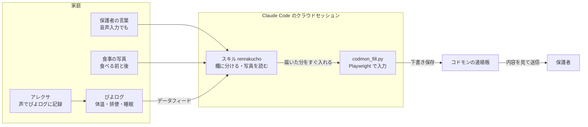

# codmon4claude

保育園の連絡帳アプリ「コドモン」の、毎朝の入力を Claude で楽にするツールです。

保護者の書いた文章と、晩ごはん・朝ごはんの写真、育児記録（ぴよログ、使っている家庭だけ）をもとに、Claude がコドモンの連絡帳を入力します。送信は保護者が内容を確認してから行います。

Built with Claude: Japan 2026 の参加作品として開発中です。

コドモンの公式のツールではありません。株式会社コドモンとは関係のない、個人が作ったツールです。

## 仕組み



- 保護者は Claude アプリの Code タブから、連絡帳専用のクラウド環境で話しかけます。PC は要りません
- 保護者の文章を最優先にして、書かれていない欄だけを写真とぴよログの記録から埋めます
- コドモンには公開の API が無いので、保護者の代わりに Web 版の画面で入力し、下書き保存までで止めます。送信は保護者が押します
- 会話の始まりにフック（`scripts/setup_check.py`）が準備を点検し、足りない所を 1 つずつ案内します
- ぴよログは使わなくても構いません。開発者の家では、アレクサに話しかけてぴよログに記録しています

## はじめの準備

最初に 1 回だけ行います。スマホだけでできます。

用意するもの:

- Claude の有料プラン（Pro 以上）
- コドモンのログインに使うメールアドレスとパスワード
- GitHub のアカウント（無料。持っていなければ手順の中で作ります。このリポジトリをフォークして使います）
- ぴよログ（使っている人だけ。iOS 版 9.4.0 以上）

Claude アプリのチャットで、次の文を送ります。この後の手順を 1 つずつ案内してくれます。

```
https://github.com/ethfumi/codmon4claude/blob/main/docs/setup.md を読んで、この準備を 1 つずつ案内してください。一度に出す操作は 1 つだけにしてください。パスワードと URL は、この会話に貼らせないでください。
```

コドモンのパスワードとぴよログの URL は、チャットに貼らず、環境の設定にだけ入れます。

詳しい手順は [docs/setup.md](docs/setup.md) にあります。

## 使い方

1. Claude アプリの Code タブで、連絡帳専用のクラウド環境とこのリポジトリを選んで始める
   - 新しいセッションの画面では、前の会話のリポジトリが選ばれたままのことがあります。送る前に見てください。別のリポジトリのまま始めてしまった時に貼る文は、[docs/setup.md の「別のリポジトリのまま始めてしまった時」](docs/setup.md#別のリポジトリのまま始めてしまった時)にあります
2. 何か一言送ると、今の連絡帳の様子が表で出ます。空の欄には、いつもの値が「（推測）」付きで出ます。この時点ではコドモンは変わりません
3. 連絡帳に書きたいことを、いつもの書き方のまま送る（「朝 パン完食」「お迎え18時パパ」など。決まった文があれば、それを貼るだけで構いません）。書いた所はそのまま使われます
   - 夜のうちに送っても構いません。送った分はその場で次の朝の連絡帳に下書き保存され、朝は残りだけで済みます
4. 書かなかった所は、ぴよログの記録（使っている家庭だけ）と写真から埋めます。それでも足りない欄は、前の 30 日の連絡帳の「いつもの値」で入れて、表に「（推測）」と出します。食事の写真は 1 食につき 1 枚か 2 枚
   - 1 枚: 食べる前の写真。全部食べた（完食）として書きます
   - 2 枚: 食べる前と食べた後の写真。残した物を見て、どれをどれだけ食べたかを書きます
5. Claude が確認を待たずにコドモンの連絡帳に入力して下書き保存し、何を入力したかを表で返します。会話は閉じて構いません
   - 写真で自信の無い品目も、いちばん近い名前で入れます。表に「（推測）」と出るので、違っていたら、そのまま話して直せます
6. 直したい所や足したいこと（「今朝ちょっと鼻水」など）があれば、そのまま送ります。入れ直して保存します
7. コドモンのアプリで内容を見て、送信を押す

保存は 10 秒ほどで終わります。クラウドで動くので、送った後はアプリを閉じても進みます。

## 自分で直したい時

連絡帳を使う会話からは、コミットや PR を作れないようにしてあります。自分のフォークを直したい時は、連絡帳専用の環境の設定の「環境変数」に次の行を足します。

```
CODMON4CLAUDE_DEV=1
```

この行を入れても、送る変更にコドモンのパスワード・メールアドレス、ぴよログの URL、お子さんの名前、園の名前が入っている時は止まります。
